<picture><source media="(prefers-color-scheme: dark)" srcset="assets/hero-dark.svg"></picture>

<picture><source media="(prefers-color-scheme: dark)" srcset="assets/social-l-dark.svg"></picture><a href="mailto:dev@sukamcd.tech"><picture><source media="(prefers-color-scheme: dark)" srcset="assets/social-1-dark.svg"></picture></a><a href="https://linkedin.com/in/FabianRizkyPratama"><picture><source media="(prefers-color-scheme: dark)" srcset="assets/social-2-dark.svg"></picture></a><a href="https://instagram.com/not.vkqldks"><picture><source media="(prefers-color-scheme: dark)" srcset="assets/social-3-dark.svg"></picture></a><picture><source media="(prefers-color-scheme: dark)" srcset="assets/social-r-dark.svg"></picture>

<a href="https://github.com/SukaMCD/Portfolio"><picture><source media="(prefers-color-scheme: dark)" srcset="assets/project-portfolio-dark.svg"></picture></a>&emsp;<a href="https://github.com/SukaMCD/automitsubishijakarta"><picture><source media="(prefers-color-scheme: dark)" srcset="assets/project-automitsubishijakarta-dark.svg"></picture></a>

<a href="https://github.com/SukaMCD/warkop-sute"><picture><source media="(prefers-color-scheme: dark)" srcset="assets/project-warkop-sute-dark.svg"></picture></a>&emsp;<a href="https://github.com/SukaMCD/MEMORY-CARD-GAME"><picture><source media="(prefers-color-scheme: dark)" srcset="assets/project-memory-card-game-dark.svg"></picture></a>

<picture><source media="(prefers-color-scheme: dark)" srcset="assets/stack-dark.svg"></picture>

<picture><source media="(prefers-color-scheme: dark)" srcset="assets/stats-dark.svg"></picture>

<picture><source media="(prefers-color-scheme: dark)" srcset="assets/wave-dark.svg"></picture>

<a href="https://sukamcd.tech"><picture><source media="(prefers-color-scheme: dark)" srcset="assets/button-1-dark.svg"></picture></a>&nbsp;&nbsp;<a href="https://github.com/SukaMCD?tab=repositories"><picture><source media="(prefers-color-scheme: dark)" srcset="assets/button-2-dark.svg"></picture></a>

<a href="https://metawka.github.io/expressive-profile/?from=SukaMCD"><picture><source media="(prefers-color-scheme: dark)" srcset="assets/credit-dark.svg"></picture></a>

